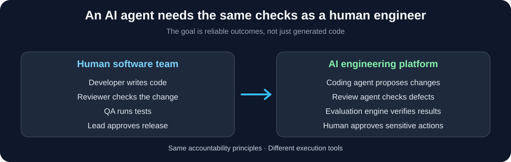
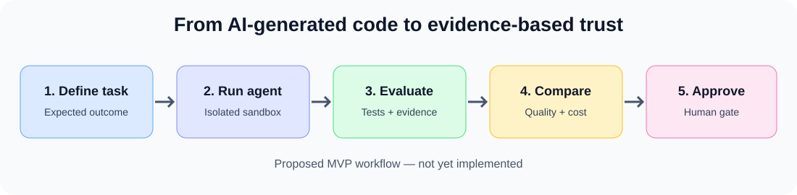

# AI Engineering Platform

**Make AI coding agents accountable, measurable, and safe to use.**

An evaluation-first platform for teams building with AI coding agents. Instead of trusting code because an AI says "done," we want evidence: **did the change work, did it pass the right checks, what did it cost, and is it safe to approve?**

> **Project status:** Planning and design. The diagrams and workflow below illustrate the intended product; they are not screenshots of a working application.



## Why build this?

Imagine hiring a new software engineer. You wouldn't ask them to modify production, skip code review, and deploy immediately just because they confidently said the bug was fixed.

You would:
1. Give them a clear task and definition of done.
2. Let them work in a controlled development environment.
3. Ask for tests and a review of their changes.
4. Compare the result with the expected behavior.
5. Require approval before releasing the change.

**AI agents deserve the same engineering discipline.** They can write code quickly, but speed and confidence are not proof of correctness. An agent might pass a superficial check while breaking an unrelated feature, using excessive tokens, or requesting permissions it should not have.

This platform aims to be the **team lead + QA process + performance dashboard** for AI-powered engineering workflows. Humans remain accountable for consequential decisions.

## A concrete use case: a broken checkout

**Scenario:** A GitHub pull request changes the checkout flow. An AI coding agent proposes a fix for a discount-calculation bug.

**Without this platform:** The agent says "fixed," a developer skims the diff, and the team has limited evidence about edge cases, regressions, or cost.

**With the planned platform:**

| Step | Human-team analogy | Platform behavior |
| --- | --- | --- |
| Assign | Team lead writes a ticket | Register a task with acceptance checks |
| Work | Developer codes on a branch | Run an approved agent against an isolated test repository |
| Test | QA verifies edge cases | Execute deterministic tests and collect artifacts |
| Review | Reviewer checks the change | Show failures, traces, and a baseline comparison |
| Decide | Lead approves the release | Human approval is required for external write actions |

For example, the evaluation can verify that a 10% discount is applied correctly, that invalid coupon codes are rejected, and that checkout totals do not regress. It can also record test pass rate, run duration, and estimated model cost.

**Important:** Automated PR repair and browser checkout testing are future modules. The first MVP focuses on defining tasks, running isolated evaluations, and comparing results.

## How the MVP is intended to work



The initial MVP will let a team:

- **Define** versioned tasks, test fixtures, expected outcomes, and agent configurations.
- **Run** approved agent configurations in time-limited, isolated environments.
- **Evaluate** results with deterministic checks and clearly labeled failures.
- **Compare** agent/model versions by task success, latency, and estimated cost.
- **Inspect** traces and artifacts to understand why a run failed.
- **Control** access with workspace permissions and approvals for external writes.

### What questions should the product answer?

- Did the agent actually solve the requested task?
- Which tests passed, and which failed?
- Did a new prompt or model introduce a regression?
- How many retries and human corrections were required?
- What is the cost **per successful task**, not just per API call?
- Can we explain and audit what the agent did?

## Product roadmap

| Phase | Capability | Status |
| --- | --- | --- |
| 1 | Agent Evaluation Platform: datasets, sandbox runs, tests, comparisons | **Planned MVP** |
| 2 | GitHub PR investigation and proposed fixes | Future |
| 3 | Multi-model routing based on task, cost, and quality | Future |
| 4 | Browser-based QA and end-to-end journey tests | Future |
| 5 | Expanded AgentOps monitoring, policy, and governance | Future |

We will prioritize reliable evaluation before increasing agent autonomy.

## Proposed architecture

```text
Developer / Engineering Team
            |
       Web Dashboard
            |
       FastAPI Service
            |
    Authorization + Queue
            |
   Isolated Agent Runner
            |
  Tests + Evaluation Engine
            |
 Results / Traces / Metrics
            |
  Baseline Comparison + Review
            |
  Human Approval for Writes
```

**Proposed stack:** Next.js + TypeScript, FastAPI + Python, PostgreSQL, Redis/Celery, isolated container runners, GitHub App integration, and OpenTelemetry. Final choices are subject to architecture review.

## What this project is NOT

- Not a promise that AI-generated code is always correct.
- Not an autonomous system that merges or deploys without authorization.
- Not a production-ready product today.
- Not an attempt to replace engineering judgment with a single AI-generated score.

## Documentation

| Document | Purpose |
| --- | --- |
| [Product requirements](docs/01-PRD.md) | Users, problem, MVP scope, and success measures |
| [Software requirements](docs/02-SRS.md) | Functional and nonfunctional requirements |
| [Architecture](docs/03-ARCHITECTURE.md) | Components, data flow, and trust boundaries |
| [Technology choices](docs/04-TECH-STACK.md) | Proposed implementation stack |
| [Data model and APIs](docs/05-DATA-API.md) | Entities, endpoints, and run lifecycle |
| [Security](docs/06-SECURITY.md) | Permissions, isolation, and audit controls |
| [Roadmap](docs/07-ROADMAP.md) | Milestones, risks, and exit criteria |
| [Development guidelines](docs/08-DEVELOPMENT.md) | Quality standards and contribution process |

## Guiding principles

**Evidence over confidence.** **Evaluation before automation.** **Least privilege.** **Human approval for sensitive actions.** **Reproducible results.**

## Current status and contributing

This public repository currently contains planning documents and original explanatory SVG diagrams. There is no working app or supported installation procedure yet. We welcome design discussion through GitHub issues once contribution and governance policies are finalized.

## License

No license has been selected. Public repository visibility does not grant permission to reuse, modify, or redistribute the contents.
